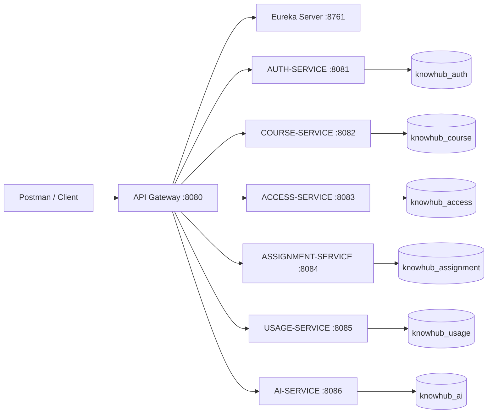

# LEARNKNOW

LEARNKNOW is a Spring Cloud microservice backend for programming learning and knowledge management. It is designed for Review 1 demonstrations through Postman and uses Java 21, Spring Boot 3.4.5, Spring Cloud 2024.0.1, Maven, PostgreSQL, JPA, Eureka, and Spring Cloud Gateway.

## Architecture



## Services and Ports

| Service | Port | Responsibility |
|---|---:|---|
| eureka-server | 8761 | Service discovery dashboard and registry |
| api-gateway | 8080 | Single client entry point and load-balanced routes |
| auth-service | 8081 | Registration, BCrypt passwords, login, JWT, user lookup |
| course-service | 8082 | Courses, modules, and learning resources |
| access-service | 8083 | Enrollment and access checks |
| assignment-service | 8084 | Assignments and code submissions |
| usage-service | 8085 | Activity history and progress |
| ai-service | 8086 | Persisted rule-based programming doubt assistant |

## Database Setup

PostgreSQL 17 is supported. Each service uses a separate database:

`knowhub_auth`, `knowhub_course`, `knowhub_access`, `knowhub_assignment`, `knowhub_usage`, and `knowhub_ai`.

Run [database_setup.sql](database_setup.sql) from pgAdmin or `psql` while connected to the PostgreSQL maintenance database. `CREATE DATABASE` statements must be run outside a normal transaction. Configure these environment variables before starting services:

```powershell
$env:DB_USERNAME="postgres"
$env:DB_PASSWORD="your-password"
$env:JWT_SECRET="a-long-development-secret-at-least-32-characters"
```

The six service-specific PostgreSQL URLs are configured in their `application.yml` files. Hibernate uses `ddl-auto: update` for development.

## Running

From the project root, build everything:

```powershell
mvn clean package
```

Start Eureka first, then the services in separate terminals:

```powershell
mvn -pl eureka-server spring-boot:run
mvn -pl auth-service spring-boot:run
mvn -pl course-service spring-boot:run
mvn -pl access-service spring-boot:run
mvn -pl assignment-service spring-boot:run
mvn -pl usage-service spring-boot:run
mvn -pl ai-service spring-boot:run
mvn -pl api-gateway spring-boot:run
```

Open the Eureka dashboard at `http://localhost:8761`. Client services register using their configured application names and the default registry URL `http://localhost:8761/eureka/`.

## Gateway Routes

The gateway maps `/api/auth/**`, `/api/courses/**`, `/api/access/**`, `/api/assignments/**`, `/api/usage/**`, and `/api/ai/**` to the corresponding Eureka service using `lb://SERVICE-NAME` routes. Use `http://localhost:8080` for client requests.

## JWT Flow

1. `POST /api/auth/register` creates a user with a BCrypt-hashed password.
2. `POST /api/auth/login` validates credentials and returns a JWT containing `userId`, `email`, and `role`.
3. Send `Authorization: Bearer <token>` on protected auth lookups and application requests.
4. JWT secret and expiration are configurable through `JWT_SECRET` and `JWT_EXPIRATION_MS`.

## Main API List

- `POST /api/auth/register`, `POST /api/auth/login`, `GET /api/auth/users/{id}`
- `GET/POST/PUT/DELETE /api/courses`, `GET /api/courses/{id}`
- `GET/POST /api/courses/{courseId}/modules`
- `GET/POST /api/courses/modules/{moduleId}/resources`
- `POST /api/access/enroll`, `GET /api/access/user/{userId}`, `GET /api/access/check/{userId}/{courseId}`, `POST /api/access/validate`
- `GET /api/assignments/course/{courseId}`, `GET /api/assignments/{id}`, `POST /api/assignments`, `POST /api/assignments/{assignmentId}/submit`
- `POST /api/usage/activity`, `GET /api/usage/history/{userId}`, `POST /api/usage/progress`, `GET /api/usage/progress/{userId}/{courseId}`
- `POST /api/ai/ask`

Example AI request:

```json
{"userId":1,"question":"What is a Java NullPointerException?"}
```

## Postman Demonstration

Register and log in through `http://localhost:8080/api/auth/...`, copy the returned token, and add it as a Bearer token in the Postman Authorization tab. Create a course, enroll the user, check access, create or view an assignment, submit code, record progress, and ask the AI endpoint. The same paths work directly on service ports for isolated troubleshooting.

## Verification and Limitations

`mvn package -DskipTests` was verified before the PostgreSQL migration; rerun it after configuration changes. PostgreSQL 17 is detected and running on port `5432`. Full API flow requires PostgreSQL credentials and all services running together.

This Review 1 version uses a deterministic local AI assistant rather than a paid provider. Enrollment checks are exposed by access-service and can be composed by clients or a future orchestration layer. Future enhancements include centralized JWT validation at the gateway, inter-service OpenFeign clients for server-side authorization, richer role policies, automated integration tests with Testcontainers, and production secrets/configuration management.
